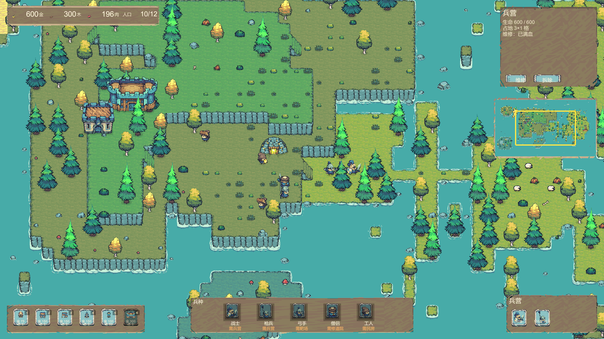
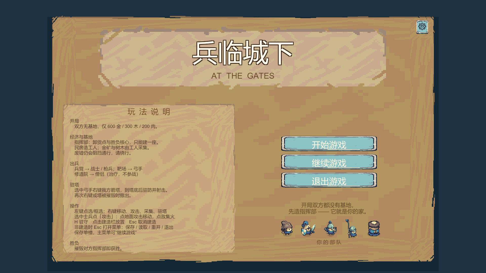
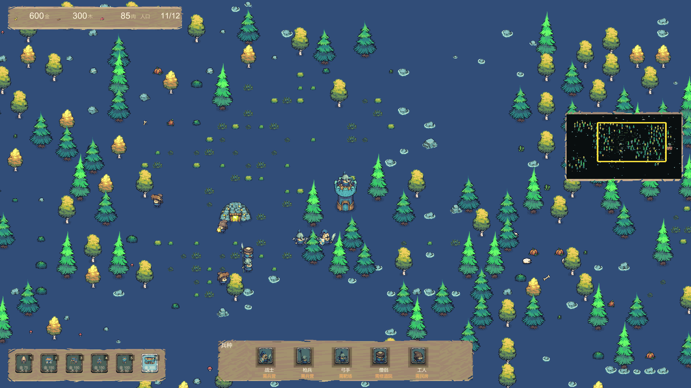

# 兵临城下 · At the Gates

2D 像素风**即时战略（RTS）**单机原型：网格建造、资源采集、人口与维护费、科技树、AI 对手、存档。

| 项目 | 说明 |
| --- | --- |
| 引擎 | 团结引擎 1.8.3（Unity 2022.3.62t5 内核） |
| 语言 | C# |
| 渲染 | URP 2D |
| 代码规模 | 约 120 个 C# 脚本（含编辑器工具与 PlayMode 回归测试） |
| 运行方式 | 编辑器内 Play（未发布可执行包） |

## 实机截图







## 已实现系统

- **建造与地形**：网格化放置、多格占地校验、占用/非法位置拒绝、拆除返还、废墟与可清理地块、树木摇摆等环境表现。
- **资源经济**：金币 / 木材 / 食物三类资源；工人采集、载货、入库；资源上下限；维护费与断粮惩罚。
- **人口与产能**：人口上限、职业与战斗单位上限、生产前置建筑校验、队列与退款。
- **兵种**：战士、枪兵、弓手、僧侣（治疗）、工人（采集 / 维修）；近战追击、远程弹道、命中与伤害结算。
- **驻塔**：弓手可进入箭塔，获得塔顶站位与射界；出塔后恢复常规行为。
- **科技树**：三系科技研究，消耗、进度、增益与存档一致；AI 同样会研究科技。
- **AI 对手**：发展经济、按兵种份额配比建军、进攻波次、撤退、维修建筑。
- **中立生物**：羊的小范围游走，移动时重算占地并校验连通性。
- **操作与指挥**：点选 / 框选、右键指令、A-move 攻击移动、Ctrl+数字保存编队、数字键召回、Shift+右键巡逻、驻停与拆除。
- **界面**：主菜单、模式选择、暂停菜单、小地图、资源与人口 HUD、选中面板、生产 / 科技面板。
- **存档**：单槽完整存档与继续游戏；无存档时不显示继续入口。

## 操作说明

| 操作 | 效果 |
| --- | --- |
| 左键 / 拖拽 | 点选、框选单位或建筑 |
| 右键 | 移动、攻击、采集、维修等上下文指令 |
| HUD 攻击按钮 | 进入 A-move 攻击移动 |
| Ctrl + 数字 / 数字 | 保存编队 / 召回编队 |
| Shift + 右键 | 巡逻 |
| H / Delete | 驻停 / 拆除选中建筑 |
| Esc | 暂停菜单（可保存、退出到主菜单） |

其余快捷键以游戏内提示为准。

## 快速开始

1. 用团结引擎 Hub 安装 **2022.3.62t5 / Tuanjie 1.8.3**。
2. 在 Hub 中 Open 本目录，等待首次资源导入（`Library/` 由引擎自动生成）。
3. 打开 `Assets/Scenes/MainMenu.scene` 点击 Play；也可直接打开 `Assets/Scenes/SampleScene.scene` 进入主战场。

场景：`MainMenu`（主菜单）、`ModeSelect`（模式选择）、`SampleScene`（主战场）。

## 目录结构

```
Assets/
  Scripts/     运行时逻辑（指挥、经济、战斗、AI、存档、UI）
  Editor/      编辑器工具与回归测试入口
  Tests/       PlayMode 回归测试
  Art/         像素美术与 UI 素材（含第三方素材）
  Scenes/      场景
  Settings/    渲染管线与项目资产
docs/
  superpowers/specs    各阶段设计文档
  superpowers/plans    实施计划
  superpowers/reports  验收与审计报告
  screenshots/         实机截图
```

## 测试与工程实践

- 最近一次全量 PlayMode 回归 **274/274 通过**（2026-11-09），详见
  `docs/superpowers/reports/2026-11-09-rts-final-gameplay-hud-verification.md`。
- 开发过程采用「设计 → 计划 → 实施 → 验收」文档流，关键修复附变异证明（临时移除被测逻辑，确认测试确实会变红）。
- 报告中区分了自动化断言、真实场景探针与截图证据各自的覆盖边界。

## 已知边界

- 无音频。
- 难度选择已完成设计，尚未实现。
- 验收以自动化测试与截图为主，未做完整的真人长局键鼠验收；部分 UI 文案仍待打磨。

## 第三方素材与许可

见 [THIRD_PARTY_NOTICES.md](THIRD_PARTY_NOTICES.md)。本仓库代码与文档仅供学习与面试评估，保留所有权利；第三方素材遵循其原始许可。
